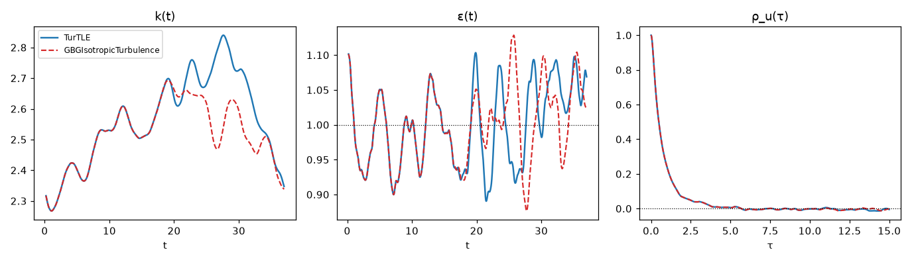
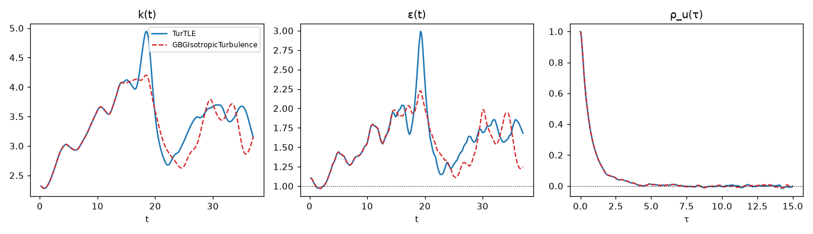
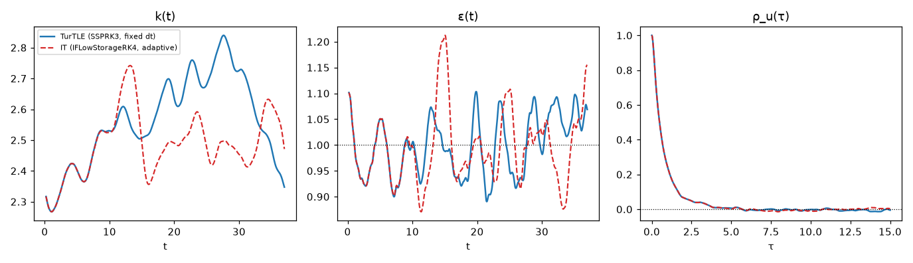

# Validation — code-to-code comparison against TurTLE

!!! note "Comparison completed 2026-08-28"
    Both legs of the comparison have run and the results below are measured. The initial state
    and both reference-data files are published as release assets; every number on this page is
    reproducible from them with the scripts in the repository's `validation/` directory.

The package is validated against **TurTLE** — an independent, production pseudo-spectral DNS code
(Lalescu, Bramas, Rampp & Wilczek,
[*An efficient particle tracking algorithm for large-scale parallel pseudo-spectral simulations of turbulence*](https://doi.org/10.1016/j.cpc.2022.108406),
*Comput. Phys. Commun.* **278**, 108406, 2022) — run at an identical physics point, with the same
time-stepping tableau, an exactly matched dealiasing filter, the same initial state, and the same
``10^4`` tracer particles. Under those conditions the two codes solve the same discrete system up
to one deliberate difference of route: TurTLE's `NSVEparticles` evolves the **vorticity**
formulation while this package evolves the velocity (rotational) form. The two solutions therefore
separate not from pure roundoff but from that formulation-level seed (measured ``\sim 10^{-12}``
after one time unit), growing at the flow's Lyapunov rate — a finite window of exact tracking,
followed by statistical agreement. Both behaviors are quantified below.

TurTLE version: **8.2.1** (its current release at the time of the comparison).

## The physics point

One forced, statistically stationary run of homogeneous isotropic turbulence:

| quantity | value | notes |
|:---|:---|:---|
| grid, box | ``128^3``, ``L = 2\pi`` | |
| precision | `Float64` both codes | |
| viscosity | ``\nu = 9.032 \times 10^{-3}`` | from the resolution criterion, see below |
| forcing | constant power ``\varepsilon_{\mathrm{inj}} = 1`` into shells 1–2 | ``\varepsilon = 1`` exactly at stationarity |
| dealiasing | smooth (Hou–Li) filter, exactly matched | see below |
| field scheme | `IFSSPRK3` ⇔ TurTLE's native SSPRK3 | same tableau, same stage arrangement |
| timestep | fixed ``\Delta t = 2 \times 10^{-3}`` | identical in both codes |
| particles | ``10^4`` tracers, AB4, cubic-spline interpolation | identical particles in both codes |
| window | 18,400 steps = 36.8 time units ≈ 14.9 ``k/\varepsilon`` | from the frozen handoff state |

The viscosity is set by the **resolved** resolution criterion ``\kappa_{\max}\eta = 1.5``: under
the smooth filter the resolved band ends at ``\kappa_{\mathrm{eff}} = 0.8 \kappa_{\mathrm{Ny}} = 51.2``
(the per-step filter damping overtakes the viscous rate ``\nu\kappa^{2}`` there), so
``\eta = 1.5/51.2`` and ``\nu = (\varepsilon\eta^{4})^{1/3} = \eta^{4/3}``. The grid-band figure is
``\kappa_{\mathrm{Ny}}\eta = 1.875``. (TurTLE's own reported `kMeta` = 1.476 is the same
convention with its cutoff normalized by ``N/2 - 1`` instead of ``N/2``.) Because the forcing
fixes the injection rate, ``\varepsilon`` is an *input*; the velocity scale ``u'`` and
``\mathrm{Re}_\lambda`` are *outputs* — their agreement is part of the test.

## Matching the smooth filter exactly

Both codes damp each mode by ``\exp(-s (\kappa/\kappa_{M})^{36})``, but they normalize
differently: TurTLE by ``\kappa_{M} = (N/2 - 1)`` (its highest mode with a nonzero conjugate
partner), this package by the Nyquist ``N/2``. The two filters are made *identical to machine
precision* by choosing this package's strength as

```math
s = 36 \Bigl(1 - \frac{2}{N}\Bigr)^{-36},
```

which at ``N = 128`` gives ``s = 63.463`` — the value the run uses with
`HouLi(order = 36, strength = 63.463)`.

## The shared initial state, and the import witnesses

Both codes started the comparison window from **the same TurTLE-generated state**: a 50-turnover
warm-up, then ``10^4`` tracers seeded and advanced 100 steps so the fourth-order Adams–Bashforth
integrator carried an authentic sample history. The joint state — the vorticity field in spectral
representation, the tracer positions, and the four-slot history — was frozen as
`handoff_initial_state_iter100.h5`. TurTLE continued from it natively; this package imported it:
an axis permutation between the storage layouts, an amplitude rescale (TurTLE stores Fourier
*mode amplitudes*; this package stores the unnormalized-transform convention — a factor
``N^{3}``), the inverse curl
``\hat{\boldsymbol{u}} = \mathrm{i} \boldsymbol{\kappa} \times \hat{\boldsymbol{\omega}} / \lvert\boldsymbol{\kappa}\rvert^{2}``,
and the tracer positions and history into the particle integrator's registers.

Every step of that import is witnessed, not assumed:

| witness | result |
|:---|:---|
| state fidelity: ``k`` and ``\varepsilon`` of the imported state vs TurTLE's own ``t_0`` sample | relative difference **0.0** (bit-exact) |
| curl round trip: ``\nabla\times`` applied to the recovered velocity vs the injected vorticity | ``1.4 \times 10^{-16}`` |
| interpolation parity: ``\boldsymbol{u}(t_0, \boldsymbol{X}_0)`` sampled by this package's Catmull–Rom vs TurTLE's stored I4O3 sample | ``1.6 \times 10^{-14}`` over all ``10^4`` tracers |
| AB4 history slot order | pinned bitwise against TurTLE's stored per-step samples |

## Results

### Energy and dissipation, ``k(t)`` and ``\varepsilon(t)``



Window means ``\langle\cdot\rangle_T`` over the 14.9 turnovers (each code its own realization after decorrelation):

| quantity | this package | TurTLE | relative difference |
|:---|:---|:---|:---|
| ``\langle\varepsilon\rangle_T`` | 0.9990 | 0.9987 | ``3 \times 10^{-4}`` |
| ``\langle k\rangle_T`` | 2.517 | 2.565 | ``1.9\%`` |
| ``u'`` | 1.295 | 1.308 | ``0.9\%`` |
| ``\mathrm{Re}_\lambda`` | 68.4 | 69.7 | ``1.9\%`` |

The dissipation means agree to ``3 \times 10^{-4}`` because both are pinned by the identical
forcing; ``k``, ``u'`` and ``\mathrm{Re}_\lambda`` differ at the percent level, which is the
sampling scatter of two 15-turnover realizations of the same statistics.

Pointwise, the two solutions track and then separate exactly as deterministic chaos requires:

| ``t`` | relative ``\lvert\Delta k\rvert`` |
|:---|:---|
| 0 | 0 (identical state) |
| 1 | ``6 \times 10^{-12}`` |
| 5 | ``1 \times 10^{-10}`` |
| 10 | ``2 \times 10^{-7}`` |
| 20 | ``1.3 \times 10^{-2}`` |
| 36 | ``1.1 \times 10^{-2}`` |

Ten significant digits of agreement persist through two full turnovers; the subsequent exponential
growth is the flow's Lyapunov divergence acting on the ``\sim 10^{-12}`` formulation seed, and the
saturation level is the flow's own fluctuation amplitude — the two curves ride the same band with
independent phases.

### Lagrangian velocity autocorrelation, ``\rho_u(\tau)``

The estimator is the single-origin ensemble form,

```math
\rho_u(\tau) = \frac{\langle \boldsymbol{u}(\tau)\cdot\boldsymbol{u}(0) \rangle}{\langle \lvert\boldsymbol{u}(0)\rvert^{2} \rangle},
```

the dot product averaged over the ``10^4`` tracers with ``\boldsymbol{u}(0)`` frozen at the
handoff instant. This package computes it **online in the run's observation callback** (the
initial sample is stored once; each instant contributes one scalar); TurTLE's curve is computed
from its stored trajectory samples with the identical formula. Because both codes share
``\boldsymbol{u}(0)`` and the particles, the curves are comparable realization to realization:

| ``\tau`` | ``\rho_u`` (both codes) | ``\lvert\Delta\rho_u\rvert`` |
|:---|:---|:---|
| 0.5 | 0.490 | ``1.3 \times 10^{-11}`` |
| 1.0 | 0.241 | ``4.7 \times 10^{-10}`` |
| 2.0 | 0.066 | ``5.5 \times 10^{-10}`` |
| 5.0 | 0.006 | ``1.9 \times 10^{-5}`` |

The ensemble average is far more robust to the trajectory-level phase scrambling than any single
trajectory: the curves are indistinguishable through the entire physical decay, and the largest
differences (``\sim 2 \times 10^{-2}``) occur only beyond ``\tau \approx 10``, where ``\rho_u``
itself is statistical noise of that size.

### Robustness across forcings: the Linear (Lundgren) pair

The whole comparison was repeated with a different forcing law — the band-limited **linear
(Lundgren-type) forcing** ``\boldsymbol{f} = A \boldsymbol{u}`` on the same shells, with the
**fixed** coefficient ``A = 0.42386263 = \varepsilon_{\mathrm{target}}/(2E_{\mathrm{band}}(t_0))``
(this package's `Linear(rate = A)` ⇔ TurTLE's `forcing_type = "linear"`, `famplitude = A`) — from
the *same* frozen handoff and the same ``10^4`` particles. Unlike the constant-power law, nothing
here reads the state or pins the injection: energy and dissipation are entirely outputs.



Three findings:

- **Same agreement structure.** The solutions track to eight digits at ``t = 5`` and six at
  ``t = 10`` (relative ``\lvert\Delta k\rvert`` ``1.6 \times 10^{-9}`` at ``t = 1``,
  ``2 \times 10^{-8}`` at 5, ``3.7 \times 10^{-6}`` at 10), then separate at the Lyapunov rate.
  The divergence seed is ``\sim 500\times`` the constant-power pair's, and identifiably so: this
  package folds the steady ``A`` into its integrating factor (exact), TurTLE carries the term
  explicitly through the Runge–Kutta stages — the same continuous physics along two discrete
  routes, differing at that term's truncation level. ``\rho_u`` again overlays to
  ``2 \times 10^{-10}`` at ``\tau = 0.5`` and ``8 \times 10^{-6}`` at ``\tau = 5``.
- **The unanchored equilibrium wandered — identically in both codes.** With fixed ``A`` the band
  self-amplifies until the cascade balances it: both codes migrated to a hotter state
  (``\langle k\rangle_T \approx 3.4`` from 2.5, ``\langle\varepsilon\rangle_T \approx 1.6`` from 1.0), agreeing on the new
  attractor's statistics to ``\sim 3\%`` — the larger scatter reflecting linear forcing's
  well-known larger, slower energy fluctuations, visible in the ``k(t)`` panel.
- **The amplitude estimate illustrates why anchored forcings exist.** ``A`` was chosen from the
  *instantaneous* handoff band energy; the fixed-``A`` balance settled at a larger one
  (``\langle E_{\mathrm{band}}\rangle_T \approx 1.87`` from 1.18), so
  ``\langle\varepsilon\rangle_T = 2A\langle E_{\mathrm{band}}\rangle_T \approx 1.59`` rather than 1. Both codes agree
  precisely on this migration —
  it is the physics of unanchored linear forcing, not a discrepancy.

### Robustness across integrators: `IFLowStorageRK4` at its adaptive step

The third repetition changes the *integration machinery* instead of the forcing: the same frozen
handoff, the same ``10^4`` particles, the same constant-power forcing — but this package advances
with [`IFLowStorageRK4`](@ref) (the Carpenter–Kennedy fourth-order low-storage scheme) under its
**adaptive CFL controller** rather than the fixed matched timestep. TurTLE's leg is the original
fixed-step reference. Trajectory-level identity is off the table by construction — the two runs
share no time grid — so what this tests is statistical agreement under genuinely different
discrete routes.



- **The window took 6,739 adaptive steps at mean ``\Delta t = 0.00546`` — ``2.73\times`` the
  reference legs' fixed ``2 \times 10^{-3}``** (the fixed value was chosen for cross-code
  matching, well inside even RK3's ceiling), completing the same 36.8 time units in 174 s against
  the fixed-step leg's 265 s on the same GPU.
- **Same agreement structure, with an instructive seed ladder.** ``k`` and ``\varepsilon`` track
  at ``10^{-6}``–``10^{-5}`` relative through ``t \approx 5``, separating from a seed of
  ``\sim 6 \times 10^{-7}`` at ``t = 1`` — the *truncation-level* difference of two tableaux on
  two step sizes, against ``\sim 10^{-12}`` for the matched-tableau pair: same physics reached by
  discretizations of increasing unlikeness, separating at exactly the level each unlikeness
  predicts. Window means agree to ``0.2\%`` in ``\langle\varepsilon\rangle_T`` and ``3\%`` in ``\langle k\rangle_T``
  (two 15-turnover realizations of the same statistics).
- **``\rho_u`` is again indistinguishable** through the physical decay: ``5 \times 10^{-6}`` at
  ``\tau = 0.5``, ``2 \times 10^{-6}`` at ``\tau = 1``, ``10^{-5}`` at ``\tau = 2`` — computed
  in the run's callback on the *irregular* adaptive time grid, against TurTLE's fixed-grid
  post-hoc curve.

### Deliberately not compared in this round

Shell-averaged spectra ``E(\kappa)`` and the velocity-derivative skewness were not collected in
the comparison window; they are a natural extension, not a silent omission.

### Cost

The identical leg — 18,400 steps with ``10^4`` tracers — took TurTLE 92 minutes (8 MPI ranks × 2
threads on a 12-core CPU) and this package **265 seconds** on a single AMD RX 7900 XTX
(14.4 ms/step, `Float64`).

## Reproducing the comparison

The three published files (release assets; verify the hashes):

```
base=https://github.com/GrigorySarnitsky/GBGHomogeneousTurbulence.jl/releases/download/turtle-comparison-v1
curl -LO $base/handoff_initial_state_iter100.h5
curl -LO $base/turtle_reference_data.h5
curl -LO $base/gbgit_reference_data.h5
curl -LO $base/turtle_linear_reference_data.h5
curl -LO $base/gbgit_linear_reference_data.h5
curl -LO $base/gbgit_rk4adaptive_reference_data.h5
sha256sum *.h5
# handoff_initial_state_iter100.h5        02c2d2530a731f0701608b4fb219f28bc9006f8d2ac39f4c02daef228823e82f
# turtle_reference_data.h5                fa9633599e2f86411a9712ad75c0fad69cb047626d4f59e02de5a2802ca42211
# gbgit_reference_data.h5                 394d68ca9f6bd066eb34b484f826c684df605c6901e1eb7364d756ae1b04bf28
# turtle_linear_reference_data.h5         6b8d15e9944c3ec12b7a0a451805b62351623fd9830d98ea3aad303a205115cd
# gbgit_linear_reference_data.h5          bd192fdcca3bbe75798818bf0193af17846286e7cb3cc00d95514dc6db6670c2
# gbgit_rk4adaptive_reference_data.h5     1629764125ab00230d9a6d32fe710242075bb57264aea828113a0fe258094ca9
```

Each reference file is self-describing: datasets `t`, `k`, `ε`, `τ`, `ρ_u`, with the definitions,
run provenance, and the initial state's hash in its attributes.

The scripts live in the repository's `validation/` directory and run in a working directory
holding the downloaded files: `collect_driver.py` (TurTLE's leg; needs a TurTLE 8.2.1
installation with MPI, parallel HDF5, and FFTW), `it_leg.jl` (this package's leg — the import,
the witnesses above, and the instrumented run; the storage backend is one constant), and
`overlay_plots.py` (the figure). This package's leg in outline:

```julia
using GBGHomogeneousTurbulence
sim = Simulation(domain; viscosity = 9.032e-3,
                 velocity_forcing = ConstantPower(injection_rate = 1.0,
                                                  lowest_shell = 1, highest_shell = 2),
                 field_integration_scheme = IFSSPRK3(),
                 particle_integration_scheme = AdamsBashforth(order = 4),
                 state = imported_state, tracers = imported_tracers)
run!(observation, sim; dt = 0.002)   # the callback records k, ε, and ρ_u online
```
